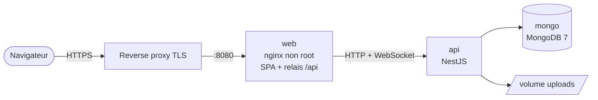

<div align="center">


# Flowboard

**Le Kanban auto-hébergé pour les équipes : boards, suivi du temps et rapports, sur votre propre serveur.**

[](https://github.com/librehubstore/flow-board/actions/workflows/docker.yml)
[](https://hub.docker.com/r/librehubstore/flow-board-api)
[](https://hub.docker.com/r/librehubstore/flow-board-web)


[Démarrage rapide](#démarrage-rapide) · [Fonctionnalités](#fonctionnalités) · [Configuration](#configuration) · [Développement](#développement) · [Documentation](#documentation)

</div>

---

Flowboard est un tableau Kanban interne, pensé pour l'entreprise : comptes gérés par un administrateur, collaboration en temps réel, suivi du temps intégré et données qui restent chez vous. Trois conteneurs, une commande pour démarrer.

## Fonctionnalités

| | |
|---|---|
| **Organiser** | Boards, colonnes et swimlanes · limites WIP (en tâches ou en pomodoros) · modèles de board · numérotation des tâches · champs personnalisés · labels et couleurs légendées · archives et corbeille |
| **Collaborer** | Mises à jour en temps réel (Socket.IO) · commentaires en Markdown avec `@mentions` · pièces jointes · notifications in-app · historique complet de chaque tâche · mode mur pour l'affichage en salle |
| **Planifier** | Échéances avec statut (bientôt, en retard, tenue) · sous-tâches assignables · tâches récurrentes (RRULE) · estimation en points ou en durée |
| **Mesurer** | Chronomètre et Pomodoro par tâche · rapports de temps passé filtrables et groupables · export CSV · impression du board |
| **Travailler vite** | Recherche globale (`/` ou `Ctrl K`) · raccourcis clavier · glisser-déposer à la souris, au tactile et au clavier · menu contextuel |
| **Administrer** | Rôles et permissions par board · journal d'audit · inscription fermée par défaut, ou ouverte avec validation email (Brevo) et connexion Google · thème clair / sombre · français et anglais |

**Qualité vérifiée en continu :** audit d'accessibilité WCAG 2.1 AA (axe) en thème clair et sombre, et un board de 1 000 tâches s'affiche en moins de 1,5 s. Les deux sont testés à chaque build par la recette Playwright.

## Démarrage rapide

Les images sont publiées sur Docker Hub ([`flow-board-web`](https://hub.docker.com/r/librehubstore/flow-board-web), [`flow-board-api`](https://hub.docker.com/r/librehubstore/flow-board-api)).

```bash
git clone https://github.com/librehubstore/flow-board.git && cd flow-board
ADMIN_USERNAME=admin ADMIN_PASSWORD='un-mot-de-passe-long' docker compose up -d
```

Ouvrez <http://localhost:8080> et connectez-vous avec `admin`. Le mot de passe initial est à changer à la première connexion.

> [!NOTE]
> L'administrateur n'est créé depuis `ADMIN_USERNAME` / `ADMIN_PASSWORD` que sur une base vide. Sans ces variables sur une base vide, l'application refuse de démarrer.

> [!IMPORTANT]
> En production, placez un reverse proxy TLS devant le port de l'application et transmettez les WebSockets (`/api/socket.io`). Exemples Caddy et nginx, sauvegarde et restauration : [`documentation/exploitation.md`](documentation/exploitation.md).

Pour construire les images localement plutôt que de les télécharger : `docker compose up -d --build`.

## Architecture



- **web** sert la SPA (Vite + React), relaie `/api` (WebSocket compris) et pose les en-têtes de sécurité.
- **api** n'expose aucun port : elle n'est joignable qu'à travers le conteneur web.
- **Données** dans deux volumes : `mongo-data` et `uploads`.

## Configuration

| Variable | Défaut | Rôle |
|---|---|---|
| `ADMIN_USERNAME`, `ADMIN_PASSWORD` | — | Premier administrateur (base vide uniquement) |
| `FLOWBOARD_PORT` | `8080` | Port publié par le conteneur web |
| `MONGO_URL` | `mongodb://localhost:27017/flowboard` | Base MongoDB (7+, mono-instance) |
| `PORT` | `3000` | Port HTTP de l'API |
| `COOKIE_SECURE` | `true` | Cookie de session `Secure` : laisser `true` derrière TLS |
| `TRUST_PROXY` | `1` (compose) | Proxys de confiance devant l'API : `1` = le conteneur web, `2` si un reverse proxy TLS est aussi devant |
| `SESSION_DAYS` | `14` | Durée glissante des sessions |
| `UPLOAD_DIR` | `/data/uploads` (image) | Stockage des pièces jointes |
| `MAX_BODY_SIZE` | `30m` | Taille maximale des requêtes (pièces jointes) |
| `APP_URL` | `http://localhost:8080` | URL publique (liens des emails, retour OAuth) |
| `GOOGLE_CLIENT_ID`, `GOOGLE_CLIENT_SECRET` | — | Connexion Google (facultatif) |
| `BREVO_API_KEY`, `MAIL_FROM_EMAIL`, `MAIL_FROM_NAME` | — | Emails transactionnels de l'inscription ouverte (facultatif) |
| `REGISTRY`, `TAG` | `librehubstore`, `latest` | Images utilisées par `docker compose` |

## Développement

Prérequis : Node 22+ et MongoDB local sur `27017`.

```bash
npm install
npm run dev:api   # API sur :3000
npm run dev:web   # UI sur :5173 (proxy /api)
```

L'API lit `apps/api/.env` (valeurs de développement, versionné) puis `apps/api/.env.local` (secrets du poste, non versionné, prioritaire). Une variable déjà présente dans l'environnement du processus l'emporte toujours. Mettez au minimum `ADMIN_USERNAME` / `ADMIN_PASSWORD` dans `.env.local` pour le premier lancement.

### Tests

```bash
npm test                            # logique partagée (node:test) + API (Jest, base Mongo jetable)
npm run build && npm run test:e2e   # recette Playwright : parcours, accessibilité, performance
npm run lint                        # ESLint + vérification de types
```

### Structure

```
packages/shared   constantes, permissions, schémas zod, règles métier pures (front + back)
apps/api          NestJS, un module par fonctionnalité
apps/web          Vite + React + Tailwind
e2e               recette Playwright
scripts           sauvegarde et restauration
```

<details>
<summary><strong>Modules de l'API</strong> (<code>apps/api/src</code>)</summary>

```
config/         variables d'environnement validées (zod), lecture de .env / .env.local
common/         décorateurs (@Public, @AdminOnly, @Perm…), pipe zod, erreurs métier, tâches périodiques
database/       module global : connexion MongoDB, collections typées, index
health/         GET /api/health (vérifie MongoDB)
board-access/   contrôle d'accès aux boards
auth/           connexion, sessions, mots de passe, garde globale (CSRF, session, rôles)
users/          profil, annuaire, administration des comptes, premier admin
audit/          journal d'audit des actions admin
settings/       paramètres d'instance
realtime/       Socket.IO : rooms par board et par utilisateur, diffusion
notifications/  notifications in-app
tasks/          tâches, journal des révisions, rappels d'échéance
boards/         boards, structure (colonnes, swimlanes), membres, corbeille
comments/       commentaires et mentions
attachments/    pièces jointes
```

Dépendances sans cycle : `database ← board-access ← auth ← realtime ← notifications ← tasks ← boards / comments / attachments`. Les suppressions en cascade passent par des événements (`task.deleted`, `board.purged`).

</details>

## Intégration continue

| Plateforme | Fichier | Étapes |
|---|---|---|
| GitHub Actions | [`.github/workflows/docker.yml`](.github/workflows/docker.yml) | build, lint, tests, recette Playwright, puis images `api` et `web` publiées sur Docker Hub (`latest` sur `main`, `X.Y.Z` / `X.Y` sur les tags `v*`) |
| GitLab CI | [`.gitlab-ci.yml`](.gitlab-ci.yml) | lint, tests et recette, images en parallèle, test de fumée de la pile, étiquetage, déploiement manuel par SSH précédé d'une sauvegarde |

## Documentation

- [Exploitation](documentation/exploitation.md) : déploiement, reverse proxy, sauvegarde, restauration, mises à jour
- [Stack technique](documentation/stack-technique.md)
- [Spécification](documentation/kanbanflow-prompt.md)
- [Plan et suivi d'avancement](documentation/plan-implémentation.md)
- [Décisions et hypothèses](DECISIONS.md)
